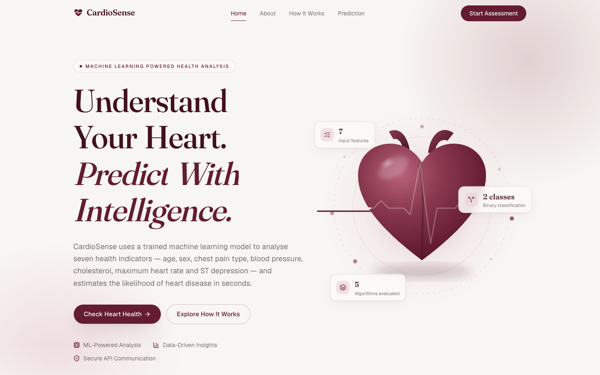
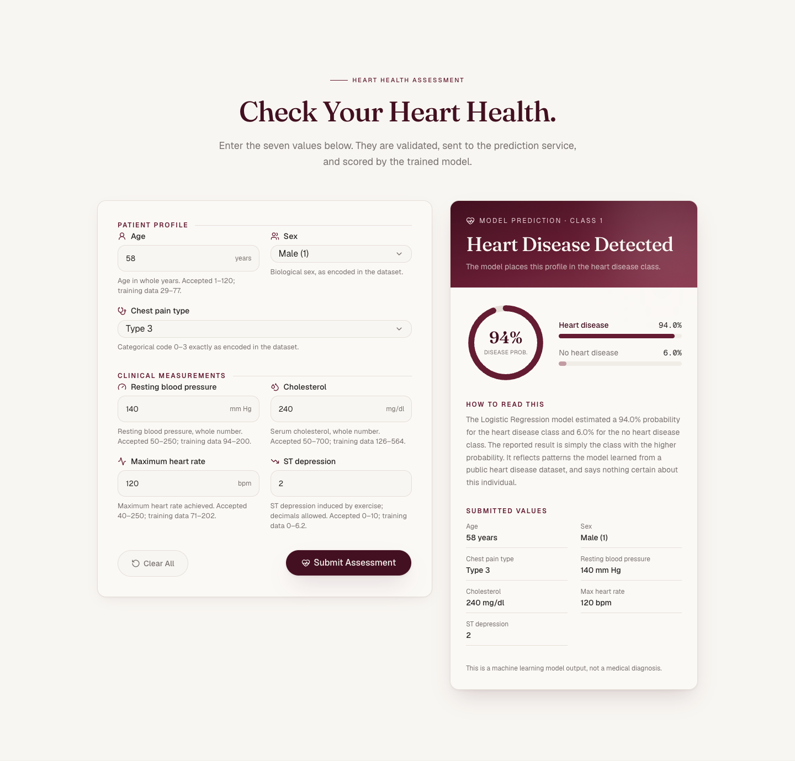
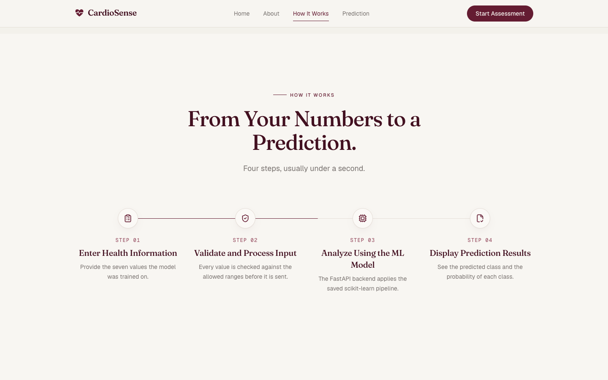
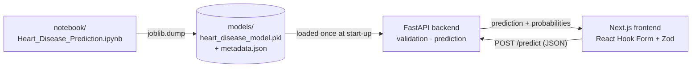

<div align="center">

# CardioSense — Heart Disease Prediction

**An end-to-end machine learning project: notebook → trained model → FastAPI service → Next.js web app.**




</div>

> **Educational project — not a medical device.** Predictions are statistical outputs of a small model trained on a public
> dataset. They are not diagnoses and must not replace professional medical evaluation.

---

## Table of contents

1. [Overview](#overview)
2. [Screenshots](#screenshots)
3. [Architecture](#architecture)
4. [Quick start](#quick-start)
5. [API reference](#api-reference)
6. [The model](#the-model)
7. [Web app](#web-app)
8. [Testing](#testing)
9. [Configuration](#configuration)
10. [Project structure](#project-structure)
11. [Retraining the model](#retraining-the-model)
12. [Troubleshooting](#troubleshooting)

---

## Overview

The project predicts whether a patient has heart disease (**binary classification**: `0` = no disease, `1` = disease)
from **seven** routine clinical measurements:

| Feature | Meaning | Encoding / unit |
|---|---|---|
| `age` | Age | years |
| `sex` | Biological sex | `0` = female, `1` = male |
| `cp` | Chest pain type | categorical code `0`–`3` (as encoded in the dataset) |
| `trestbps` | Resting blood pressure | mm Hg |
| `chol` | Serum cholesterol | mg/dl |
| `thalach` | Maximum heart rate achieved | bpm |
| `oldpeak` | ST depression induced by exercise | numeric |

It has three layers:

- **Notebook** — EDA, preprocessing, training and comparing five classifiers, exporting the best fitted pipeline.
- **Backend** — a FastAPI service that loads the saved pipeline once and serves validated predictions.
- **Frontend** — a responsive Next.js app (CardioSense) with an assessment form that calls the API. It never simulates
  results: if the API is unreachable it shows a connection error.

## Screenshots

| Assessment & live prediction | How it works |
|---|---|
|  |  |

## Architecture



- The saved artifact is a **single scikit-learn `Pipeline`** (scaling + one-hot encoding + classifier), so the API applies
  exactly the preprocessing fitted on the training data. No retraining happens at request time.
- Feature order is read from the fitted pipeline (`feature_names_in_`) and cross-checked against the metadata file.
- If the model can't be loaded the server still starts: `GET /` reports `"status": "degraded"` and model endpoints
  return `503` with the reason.

## Quick start

**Prerequisites:** Python 3.11+ (developed on 3.13), Node.js 20+, and [`uv`](https://docs.astral.sh/uv/) (optional but fast).

### 1. Backend

```bash
# from the project root
uv venv .venv && source .venv/bin/activate
uv pip install -r backend/requirements.txt

uvicorn backend.main:app --reload            # http://127.0.0.1:8000  ·  docs at /docs
```

### 2. Frontend

```bash
cd frontend
cp .env.example .env.local                   # set NEXT_PUBLIC_API_URL (see below)
npm install
npm run dev                                  # http://localhost:3000
```

`NEXT_PUBLIC_API_URL` must point at the running API, e.g. `http://127.0.0.1:8000`. If you start the API on another
port (`--port 8001`), put that URL in `.env.local` and restart `npm run dev`.

| Service | URL |
|---|---|
| Web app | http://localhost:3000 |
| API | http://127.0.0.1:8000 (or the port you chose) |
| Swagger UI | `<API URL>/docs` |

## API reference

Interactive documentation: **`<API URL>/docs`** (Swagger UI).

| Method | Path | Description |
|---|---|---|
| `GET` | `/` | Health check: status, app name, `model_loaded` |
| `GET` | `/model-info` | Model name, features, feature count, classes, test metrics |
| `POST` | `/predict` | Predict for one patient |
| `POST` | `/predict/batch` | `{"records": [...]}` → one prediction per record (max 1000) |

### Example

```bash
curl -X POST http://127.0.0.1:8000/predict \
  -H 'Content-Type: application/json' \
  -d '{"age":58,"sex":1,"cp":3,"trestbps":140,"chol":240,"thalach":120,"oldpeak":2.0}'
```

```json
{
  "prediction": 1,
  "result": "Heart Disease Detected",
  "probability": { "no_disease": 0.06, "disease": 0.94 }
}
```

### Input validation

Requests are validated with Pydantic before they can reach the model. Types are strict (no `"54"` strings, no booleans),
unknown fields are rejected, and every field is required. Invalid input returns **HTTP 422** naming the offending field.

| Field | Type | Accepted | Range seen in training data |
|---|---|---|---|
| `age` | int | 1 – 120 | 29 – 77 |
| `sex` | int | 0, 1 | 0, 1 |
| `cp` | int | 0 – 3 | 0 – 3 |
| `trestbps` | int | 50 – 250 | 94 – 200 |
| `chol` | int | 50 – 700 | 126 – 564 |
| `thalach` | int | 40 – 250 | 71 – 202 |
| `oldpeak` | float | 0 – 10 | 0.0 – 6.2 |

Accepted ranges are deliberately wider than the training data (physiologically plausible values). Inputs far outside
the training range give unreliable predictions, and the web app flags them in the result card.

| Status | Meaning |
|---|---|
| `200` | Success |
| `413` | Batch larger than the limit |
| `422` | Validation error (missing/invalid fields) |
| `503` | Model not loaded (`detail` explains why) |

## The model

- **Data:** Cleveland heart disease dataset (`data/heart_cleveland_upload.csv`, 297 rows; label column `condition` is
  renamed to `target` in the notebook). No missing values or duplicates.
- **Split:** 80/20 stratified, `random_state=42` (237 train / 60 test).
- **Preprocessing (inside the pipeline, fitted on training data only):** standard scaling for the five numeric
  features, one-hot encoding for `cp`, `sex` passed through.
- **Algorithms compared:** Logistic Regression, K-Nearest Neighbors, Random Forest, SVM (RBF), Gradient Boosting.
- **Selection:** by **F1-score** (tie-breakers: recall, then accuracy), because in screening a missed positive costs
  more than a false alarm.

Test-set results (60 rows):

| Model | Accuracy | Precision | Recall | F1 |
|---|---|---|---|---|
| **Logistic Regression** ✅ | 0.783 | 0.800 | 0.714 | 0.755 |
| KNN | 0.783 | 0.800 | 0.714 | 0.755 |
| SVM (RBF) | 0.783 | 0.800 | 0.714 | 0.755 |
| Random Forest | 0.767 | 0.769 | 0.714 | 0.741 |
| Gradient Boosting | 0.717 | 0.720 | 0.643 | 0.679 |

Three models tie exactly, and the test set is small, so differences of a few points are noise. Logistic Regression was
chosen by the tie-break order and is also the simplest. Expect modest accuracy: this is seven features and 297 patients.

## Web app

Built with **Next.js (App Router)**, React, TypeScript, Tailwind CSS v4, shadcn/ui (base-ui), Motion, Lenis,
React Hook Form and Zod.

- Off-white / burgundy editorial design system defined as CSS variables in `src/app/globals.css`.
- Animated hero (beating heart SVG with a travelling ECG pulse), scroll-triggered reveals, Lenis smooth scrolling.
- Respects `prefers-reduced-motion`: Lenis is disabled and Motion drops transform animations.
- Assessment form: grouped fields, inline validation, submit disabled until valid, loading state, Clear All.
- Result card: predicted class, class probabilities, submitted values, plain-language explanation built from the actual
  API response, and an explicit "not a diagnosis" note.
- API access is isolated in `src/lib/api.ts`; request/response types in `src/types/prediction.ts` mirror the backend schema.

## Testing

```bash
pytest                       # 36 backend tests (run from the project root)
cd frontend && npm run lint && npx tsc --noEmit && npm run build
```

The backend tests use FastAPI's `TestClient` against the real trained model. They cover health, model info, valid
predictions (compared against calling the saved pipeline directly), accuracy on the real dataset rows, 15 invalid
values, each missing feature, unknown fields, malformed JSON, batch behaviour and size limits, CORS, and
model-loading failures (missing file, corrupt file, metadata mismatch).

## Configuration

**Backend** — environment variables with prefix `HDP_`:

| Variable | Default | Purpose |
|---|---|---|
| `HDP_MODEL_PATH` | `models/heart_disease_model.pkl` | Trained pipeline |
| `HDP_METADATA_PATH` | `models/heart_disease_model_metadata.json` | Feature names, classes, metrics |
| `HDP_CORS_ORIGINS` | `localhost` / `127.0.0.1` on ports 3000 and 5173 | JSON list of allowed origins |
| `HDP_MAX_BATCH_SIZE` | `1000` | Max records per batch request |

**Frontend** — `frontend/.env.local`:

| Variable | Purpose |
|---|---|
| `NEXT_PUBLIC_API_URL` | Base URL of the FastAPI backend |

## Project structure

```text
.
├── notebook/
│   ├── Heart_Disease_Prediction.ipynb   # full ML pipeline (EDA → training → export)
│   └── requirements.{in,txt}            # notebook dependencies (jupyter, seaborn, …)
├── data/heart_cleveland_upload.csv      # Cleveland dataset
├── models/
│   ├── heart_disease_model.pkl          # fitted Pipeline (preprocessing + classifier)
│   └── heart_disease_model_metadata.json
├── backend/
│   ├── main.py            # app factory, routes, CORS, error handling
│   ├── schemas.py         # Pydantic models + validation ranges
│   ├── model_loader.py    # loads the model once; checks feature order
│   ├── prediction.py      # DataFrame construction + predict / predict_proba
│   ├── config.py          # settings (HDP_* env vars)
│   └── requirements.{in,txt}
├── frontend/
│   └── src/
│       ├── app/                  # layout, page, global styles / design tokens
│       ├── components/
│       │   ├── layout/           # Navbar, Footer
│       │   ├── sections/         # Hero, About, HowItWorks, Assessment, PredictionResult, ModelInfo, TechStack, Disclaimer
│       │   ├── visuals/          # HeartVisual (animated SVG), FloatingCard, Logo
│       │   └── ui/               # shadcn/ui primitives (button, input, select, label, form)
│       ├── hooks/                # usePrediction, useModelInfo
│       ├── lib/                  # api.ts, validations.ts, content.ts, utils.ts
│       └── types/                # API request/response types
├── tests/test_api.py
├── docs/screenshots/
└── pytest.ini
```

## Retraining the model

Open `notebook/Heart_Disease_Prediction.ipynb`, select the project's virtual environment as the kernel, and run all
cells. The last section rewrites `models/heart_disease_model.pkl` and its metadata file. Keep the same scikit-learn
version for training and serving (recorded as `sklearn_version` in the metadata). Restart the API afterwards so it
loads the new file.

## Troubleshooting

| Symptom | Fix |
|---|---|
| Web app shows "Can't reach the prediction service" | Start the API and make sure `NEXT_PUBLIC_API_URL` matches its port; restart `npm run dev` after editing `.env.local`. |
| `address already in use` on port 8000 | Another program uses it. Run `uvicorn backend.main:app --port 8001` and update `NEXT_PUBLIC_API_URL`. |
| Browser CORS error | Serve the frontend from an allowed origin, or set `HDP_CORS_ORIGINS='["http://localhost:4000"]'`. |
| `GET /` shows `"status": "degraded"` | Read `model_error`: usually a missing/corrupt `.pkl` or a scikit-learn version mismatch. Re-run the notebook. |
| `ModuleNotFoundError: backend` | Run `uvicorn`/`pytest` from the project root, not from inside `backend/`. |

---

<div align="center">
Built as an educational machine learning project. Not medical advice.
</div>
